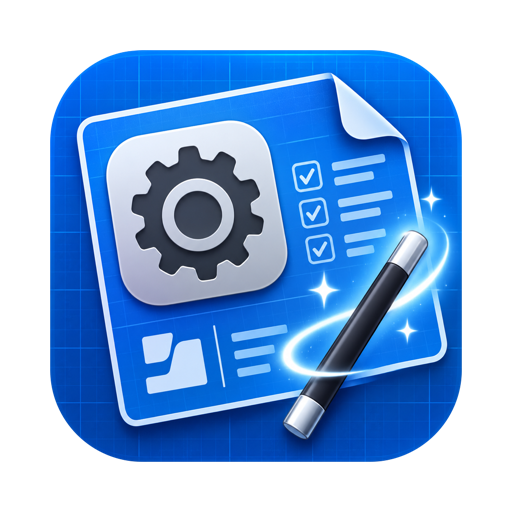
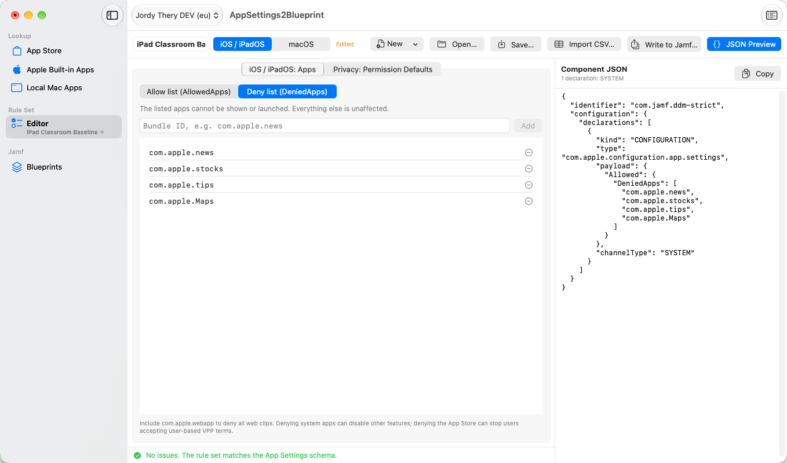
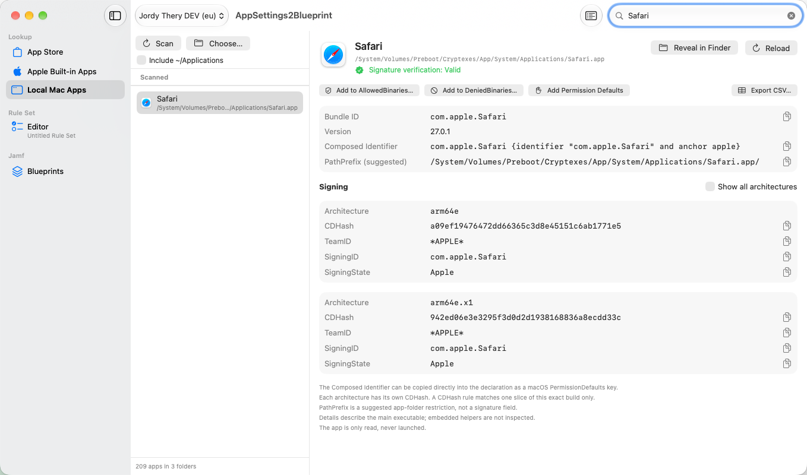

  

# AppSettings2Blueprint

*Find app identifiers, build App Settings rules and deploy them as a Jamf Blueprint.*

## What it does

Apple's `com.apple.configuration.app.settings` declaration (iOS, iPadOS, macOS, tvOS and visionOS 27 and later) allows and denies apps and Mac binaries and sets privacy permission defaults. Writing one takes bundle IDs, CDHashes, Team IDs and designated requirements, collected from several places. AppSettings2Blueprint brings that into one app:

1. **Find identifiers** — App Store and Apple built-in bundle IDs; for local Mac apps the CDHash, TeamID, SigningID, PathPrefix and SigningState per architecture slice, plus the composed `Bundle-ID {Designated-Requirement}` identifier for privacy defaults.
2. **Build rules** in a validated editor with a live JSON preview. Rule sets save as JSON files and interoperate with App Settings Utility's CSV formats.
3. **Write to Jamf** — create or update a Blueprint through the Jamf Platform API, then deploy it after an explicit confirmation.

It is not a policy advisor: it shows what each identifier matches; you decide what to allow or deny.

## Installation

Download the latest notarized build from [Releases](https://github.com/JordyThery/AppSettings2Blueprint/releases/latest), unzip it, and move **AppSettings2Blueprint.app** to `/Applications`. Requires **macOS 15 or later**. The app checks for new releases once a day; **Check for Updates…** in the app menu checks right away.

## Permissions

In [Jamf Account](https://account.jamf.com), create an API integration scoped to the **platform environment** and grant it:

| Capability | Actions | Needed for |
| --- | --- | --- |
| `blueprints` | Read | Listing Blueprints, verifying writes, following deployments |
| `blueprints` | Create | Writing a rule set to a new Blueprint |
| `blueprints` | Update | Writing to an existing Blueprint; editing scope; restoring a backup |
| `blueprints` | Deploy | Deploying a Blueprint |
| `device-groups` | Read | Choosing scope; group names and device counts before a deploy |

The Lookup section needs no Jamf permissions and no macOS privacy permission: the app is not sandboxed and reads `/Applications`, `/System/Applications`, `/System/Cryptexes/App/System/Applications`, optionally `~/Applications`, and any app you drop on it.

## Getting started

1. Open **Settings** (⌘,), add a connection with the region, **Environment ID**, **Client ID** and **Client Secret**, and click **Test Connection**. The API has no endpoint to look up the Environment ID, so you enter it yourself.
2. Collect identifiers under **Lookup** and add them to the rule set.
3. Build the rules in the **Editor**; the JSON preview shows the declarations that will be written.
4. Click **Write to Jamf…**, choose a new or an existing Blueprint, review the diff and write.
5. Deploy from the write sheet or from **Jamf → Blueprints → Deploy…**. **Edit Scope…** in the same place changes a Blueprint's device groups.

On macOS, Apple accepts binary rules only in the system channel and Privacy only in the user channel, so a macOS rule set is written as up to two declarations in the same component. For Shared iPad, tick **Shared iPad** in the editor: the iOS declaration is then written to the user channel, as Apple requires.

## Jamf School

Jamf School environments work through the same Platform API: create the API integration for the Jamf School platform environment with the `blueprints` permissions above, and connect as usual. Writing to existing Blueprints and deploying work as with Jamf Pro. The Platform API does not list Jamf School device groups, so the app recognises a Jamf School connection and leaves scope to Jamf School: create and scope Blueprints there, and the deploy confirmation shows group IDs instead of names and device counts.

## Saving safely

The Blueprints API applies updates as a JSON merge-patch, which replaces arrays wholesale, so a careless write could delete parts of a Blueprint. The app guards against this:

- Every rule set write sends the complete `steps` array, with everything outside the App Settings component exactly as received — key order and number formatting preserved.
- The Blueprint is fetched again before the review and just before the PATCH; if it changed on the server, nothing is written.
- The full Blueprint is backed up first, to `~/Library/Application Support/AppSettings2Blueprint/Backups/<blueprint ID>/`. Backups are never overwritten and **Backups…** restores them.
- Every write is verified against a read-back of the Blueprint.
- `divisionId` is never sent; division-assigned Blueprints are read-only.
- **Edit Scope…** sends only the scope, after the same checks and backup, and verifies that the steps are unchanged. Removing groups from a deployed Blueprint needs an extra confirmation.
- Writing never deploys. Deploying needs a confirmation listing the device groups and device count, and a second one for a macOS allow list without `AlwaysAllowManagedApps` or the Apple-signed baseline.
- The HTTP layer refuses everything except GET, `POST /auth/token`, Blueprint create, update and deploy. No DELETE, no undeploy; deploy is retried on 429 only.

## Network

The app contacts only these hosts:

| Host | When | What is sent |
| --- | --- | --- |
| `{region}.api.jamfcloud.com` | Jamf sections, Test Connection | Your connection's credentials and the Blueprint requests above |
| `itunes.apple.com` | App Store search | The search term, storefront and platform |
| `uclient-api.itunes.apple.com` | App Store app details | The App Store ID and storefront |
| `is1`–`is5-ssl.mzstatic.com` | App Store search results | Requests for app icons, from the URLs Apple returns |
| `api.github.com` | Once a day, and on **Check for Updates…** | A request for the latest release; turn the daily check off in **About** |
| `github.com`, `objects.githubusercontent.com` | Only on **Download** in the update sheet | A request for the release zip |

Lookups never include Jamf data or credentials. Client secrets are stored in the keychain; the request log is kept in memory with secrets redacted; backups contain only Blueprint JSON. The app runs with the Hardened Runtime and is Developer ID signed and notarized.

## Known limitations

- **A Blueprint needs a scope before its steps can be changed.** The API rejects a steps PATCH to a Blueprint without device groups. The app refuses such writes before sending anything; set the scope with **Edit Scope…** first (in Jamf School, set it there).
- **Not Deployed versus Out of Date.** After a write, a never-deployed Blueprint stays *Not Deployed*; *Out of Date* only appears once it has been deployed. Any scope change to a deployed Blueprint also marks it *Out of Date*.
- **Embedded helpers are not inspected.** The local scan stops at the first `.app` bundle; drop helpers, XPC services or login items on the app to inspect them individually.

## Building

Open `AppSettings2Blueprint.xcodeproj` in Xcode 27 or later and build the `AppSettings2Blueprint` scheme (⌘R). No dependencies; Apple frameworks only. Unit tests (Swift Testing) run with ⌘U; UI tests with `Scripts/run-ui-tests.sh`, which writes a failing test's UI hierarchy to `/tmp/as2b-uidump.txt` and exports screenshots to `/tmp/as2b-uitest-attachments`.

## Credits

Identifier discovery is based on Anthony Darlow's **App Settings Utility**:

- Repository: [cantscript/AppSettingsUtility](https://github.com/cantscript/AppSettingsUtility)
- Blog post: [Stop Hunting for Bundle IDs & CDHashes](https://cantscript.com/posts/stop-hunting-for-bundle-ids--cdhashes/)

The App Store endpoints, the SigningState requirement strings, the composed-identifier format, the scan folders, the CSV columns and the embedded Apple app list come from his script. [THIRD-PARTY-NOTICES.md](THIRD-PARTY-NOTICES.md) lists what was ported and carries his MIT licence, also shown in **About → Acknowledgements**.

## Support

If AppSettings2Blueprint saves you time, you can [buy me a coffee](https://buymeacoffee.com/jordythery). ☕️

## License

[MIT](LICENSE). Material ported from App Settings Utility is covered by its own MIT licence; see [THIRD-PARTY-NOTICES.md](THIRD-PARTY-NOTICES.md).
