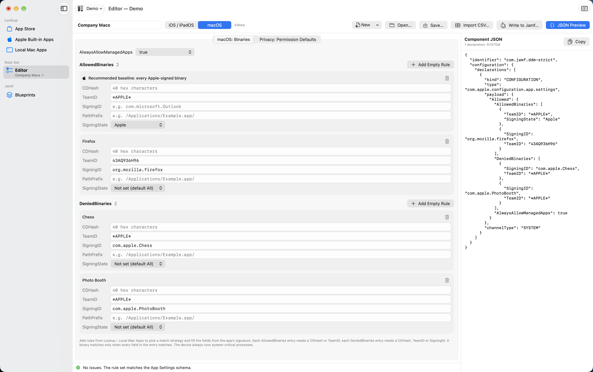
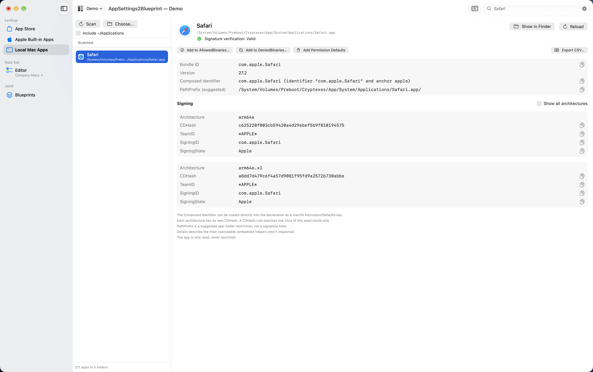

  

# AppSettings2Blueprint

*Find app identifiers, build App Settings rules and deploy them as a Jamf Blueprint.*

## What it does

Apple’s `com.apple.configuration.app.settings` declaration (iOS, iPadOS, macOS, tvOS and visionOS 27 and later) allows and denies apps and Mac binaries and sets permission defaults. Writing one takes bundle IDs, CDHashes, Team IDs and designated requirements, collected from several places. AppSettings2Blueprint brings that into one app:

1. **Find identifiers** — App Store and Apple built-in bundle IDs; for local Mac apps the CDHash, TeamID, SigningID, PathPrefix and SigningState per architecture slice, plus the composed `Bundle-ID {Designated-Requirement}` identifier for permission defaults.
2. **Build rules** in a validated editor with a live JSON preview. Rule sets save as JSON files and interoperate with App Settings Utility’s CSV formats.
3. **Write to Jamf** — create or update a Blueprint through the Jamf Platform API, then deploy it after an explicit confirmation.

It isn’t a policy advisor: it shows what each identifier matches; you decide what to allow or deny.

## Installation

Download the latest notarized build from [Releases](https://github.com/JordyThery/AppSettings2Blueprint/releases/latest), unzip it, and move **AppSettings2Blueprint.app** to `/Applications`. Requires **macOS 15 or later**. The app checks for new releases once a day; **Check for Updates…** in the app menu checks right away.

To look around first, choose **Demo Mode** in the connection picker or the Connection menu (or **Try Demo Mode** when no connection is set up). It shows a sample organization’s Blueprints and device groups; writes and deployments work on the sample data only, nothing is sent to Jamf, and window titles end in “— Demo”. App Store lookups still contact Apple, and backups made in Demo Mode go to a temporary folder. **Test Connection** always uses the real connection, even in Demo Mode.

## Permissions

In [Jamf Account](https://account.jamf.com), create an API integration scoped to the **platform environment**, or to the organization if you want **Load Environments** to list its environments, and grant it:

| Capability | Actions | Needed for |
| --- | --- | --- |
| `blueprints` | Read | Listing Blueprints, verifying writes, following deployments |
| `blueprints` | Create | Writing a rule set to a new Blueprint |
| `blueprints` | Update | Writing to an existing Blueprint; editing scope; restoring a backup |
| `blueprints` | Deploy | Deploying a Blueprint |
| `device-groups` | Read | Choosing scope; group names and device counts before a deploy |

The Lookup section needs no Jamf permissions and no macOS privacy permission: the app isn’t sandboxed and reads `/Applications`, `/System/Applications`, `/System/Cryptexes/App/System/Applications`, optionally `~/Applications`, and any app you drop on it.

## Getting started

1. Open **Settings** (⌘,) › **Connections** and add a connection with the region, **Client ID** and **Client Secret**. Click **Load Environments** to pick the **Environment ID** (organization-scoped integrations), or copy it from the integration’s details in Jamf Account, then click **Test Connection**, which signs in and checks that reading Blueprints and device groups works.
2. Collect identifiers under **Lookup** and add them to the rule set.
3. Build the rules in the **Editor**; the JSON preview shows the declarations that will be written.
4. Click **Write to Jamf…**, choose a new or an existing Blueprint, review the diff and write.
5. Deploy from the write sheet or from **Jamf › Blueprints › Deploy…**. **Edit Scope…** in the same place changes a Blueprint’s device groups. **Fetch by ID** in the toolbar loads one Blueprint by its ID.

On macOS, Apple accepts binary rules only in the system channel and Privacy only in the user channel, so a macOS rule set is written as up to two declarations in the same component. For Shared iPad, check **Shared iPad** in the editor: the iOS declaration is then written to the user channel, as Apple requires.

## Jamf School

Jamf School environments work through the same Platform API: create the API integration for the Jamf School platform environment with the `blueprints` permissions above, and connect as usual. Writing to existing Blueprints and deploying work as with Jamf Pro. The Platform API doesn’t list Jamf School device groups, so the app recognizes a Jamf School connection and leaves scope to Jamf School: create and scope Blueprints there, and the deploy confirmation shows group IDs instead of names and device counts.

## Saving safely

The Jamf Platform API applies Blueprint updates as a JSON merge-patch, which replaces arrays wholesale, so a careless write could delete parts of a Blueprint. The app guards against this:

- Every rule set write sends the complete `steps` array, with everything outside the App Settings component exactly as received — key order and number formatting preserved.
- The Blueprint is fetched again before the review and just before the PATCH; if it changed in Jamf, nothing is written.
- If a write was sent but Jamf’s answer is unclear, or reading the Blueprint back fails, the app says so and doesn’t offer to send it again (a second create would make a second Blueprint).
- The full Blueprint is backed up first, to `~/Library/Application Support/AppSettings2Blueprint/Backups/<Blueprint ID>/`. Backups are never overwritten and **Backups…** restores them. A backup holds the whole Blueprint as Jamf returned it, including the settings of its other components (such as Wi-Fi passwords), as plain JSON readable only by your user account. They’re kept forever unless you choose a shorter time in **Settings › General › Backups**; the newest backup of each Blueprint is always kept.
- Every write is verified against a read-back of the Blueprint.
- `divisionId` is never sent; division-assigned Blueprints are read-only.
- **Edit Scope…** sends only the scope, after the same checks and backup, and verifies that the steps are unchanged. Removing groups from a deployed Blueprint needs an extra confirmation.
- Writing never deploys. Deploying needs a confirmation listing the device groups and device count, and a second one for a macOS allow list without `AlwaysAllowManagedApps` or the Apple-signed baseline. Just before deploying, the Blueprint is fetched again; if its scope or steps changed since the confirmation, nothing is deployed and the confirmation is shown again.
- The HTTP layer refuses everything except GET, `POST /auth/token`, Blueprint create, update and deploy. No DELETE, no undeploy; deploy is retried on 429 only.

## Network

The app contacts only these hosts:

| Host | When | What is sent |
| --- | --- | --- |
| `{region}.api.jamfcloud.com` | Jamf sections, Test Connection, Load Environments | Your connection’s credentials and the Blueprint requests above |
| `itunes.apple.com` | App Store search | The search term, storefront and platform |
| `uclient-api.itunes.apple.com` | App Store app details | The App Store ID and storefront |
| `is1`–`is5-ssl.mzstatic.com` | App Store search results | Requests for app icons, from the URLs Apple returns |
| `api.github.com` | Once a day, and on **Check for Updates…** | A request for the latest release; turn the daily check off in **Settings › Updates** |
| `github.com` and GitHub’s download host (`*.githubusercontent.com`) | Only on **Download** in the update sheet | A request for the release zip |

Lookups never include Jamf data or credentials. Client secrets are stored in the Keychain. The activity log (**Window › Activity Log**, ⇧⌘L) shows sign-ins, Jamf API calls and App Store lookups as they happen, is kept in memory with secrets redacted, and can be exported with identifiers masked (**File › Export Activity Log for Bug Report…**) or unmasked (**File › Export Activity Log Unmasked…**). Backups contain only Blueprint JSON. The app runs with the Hardened Runtime and is Developer ID signed and notarized.

## Where data is stored

| What | Where |
| --- | --- |
| Connections (name, region, Client ID, Environment ID) and settings | The app’s preferences, `~/Library/Preferences/be.jordythery.appsettings2blueprint.plist` |
| Client secrets | Your login Keychain |
| Blueprint backups | `~/Library/Application Support/AppSettings2Blueprint/Backups/<Blueprint ID>/` |
| Activity log | Memory only, until you export it |
| Rule sets | JSON or CSV files wherever you save them |

## Known limitations

- **A Blueprint needs a scope before its steps can be changed.** The API rejects a steps PATCH to a Blueprint without device groups. The app refuses such writes before sending anything; set the scope with **Edit Scope…** first (in Jamf School, set it there).
- **Not Deployed versus Out of Date.** After a write, a never-deployed Blueprint stays *Not Deployed*; *Out of Date* only appears once it has been deployed. Any scope change to a deployed Blueprint also marks it *Out of Date*.
- **Embedded helpers aren’t inspected.** The local scan stops at the first `.app` bundle; drop helpers, XPC services or login items on the app to inspect them individually.

## Building

Open `AppSettings2Blueprint.xcodeproj` in Xcode 27 or later and build the `AppSettings2Blueprint` scheme (⌘R). The app’s only package dependency is [JTKit](https://github.com/JordyThery/JTKit), the shared package of these apps; Xcode fetches it on first build. Resolving it also downloads Microsoft’s MSAL, which JTKit uses for Intune sign-in and which this app doesn’t link or ship. Unit tests (Swift Testing) run with ⌘U; UI tests with `Scripts/run-ui-tests.sh`, which writes a failing test’s UI hierarchy to `/tmp/as2b-uidump.txt` and exports screenshots to `/tmp/as2b-uitest-attachments`.

## Credits

Identifier discovery is based on Anthony Darlow’s **App Settings Utility**:

- Repository: [cantscript/AppSettingsUtility](https://github.com/cantscript/AppSettingsUtility)
- Blog post: [Stop Hunting for Bundle IDs & CDHashes](https://cantscript.com/posts/stop-hunting-for-bundle-ids--cdhashes/)

The App Store endpoints, the SigningState requirement strings, the composed-identifier format, the scan folders, the CSV columns and the embedded Apple app list come from his script. [THIRD-PARTY-NOTICES.md](THIRD-PARTY-NOTICES.md) lists what was ported and carries his MIT license, also shown in **About › Acknowledgements**.

## Support

If AppSettings2Blueprint saves you time, you can [buy me a coffee](https://buymeacoffee.com/jordythery). ☕️

## Disclaimer

This tool is provided as-is, without warranty of any kind. Use it at your own risk. This is a personal project. It is not affiliated with or endorsed by my employer, Jamf or Apple. Issues and pull requests are appreciated. Support is best-effort.

## License

[MIT](LICENSE). Material ported from App Settings Utility is covered by its own MIT license; see [THIRD-PARTY-NOTICES.md](THIRD-PARTY-NOTICES.md).
